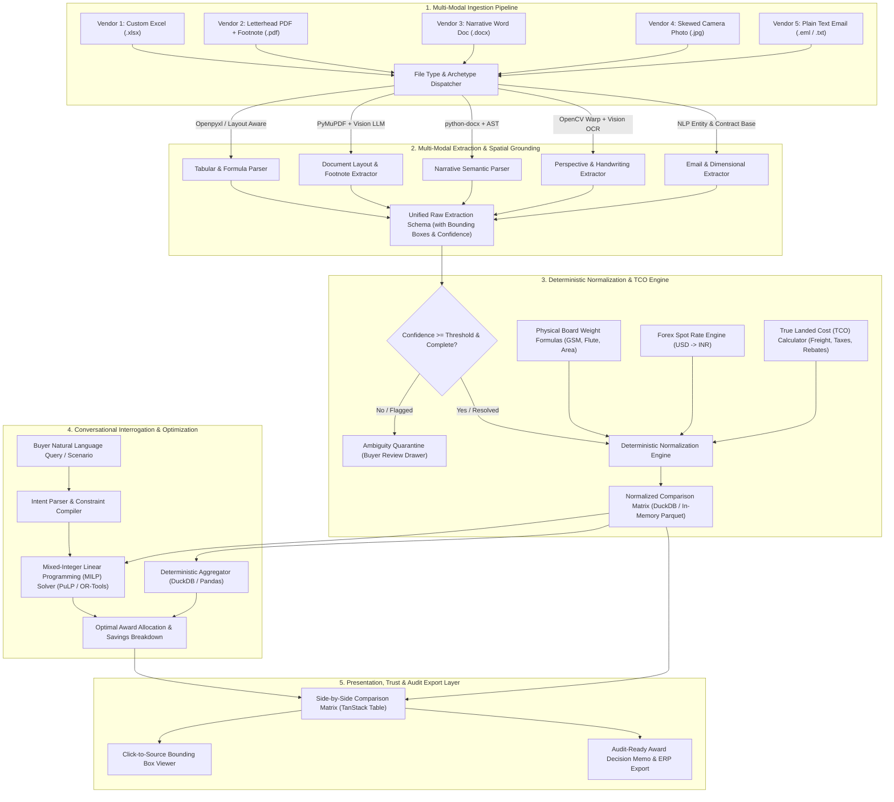
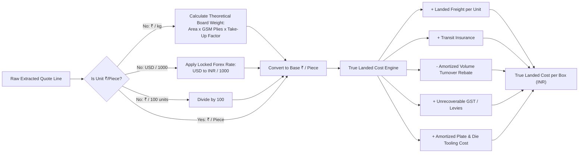
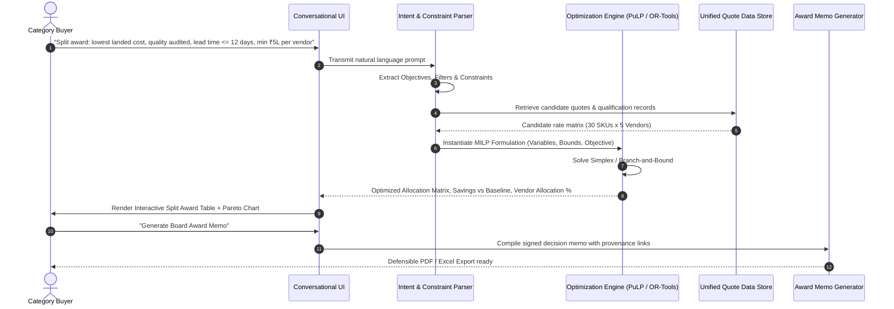
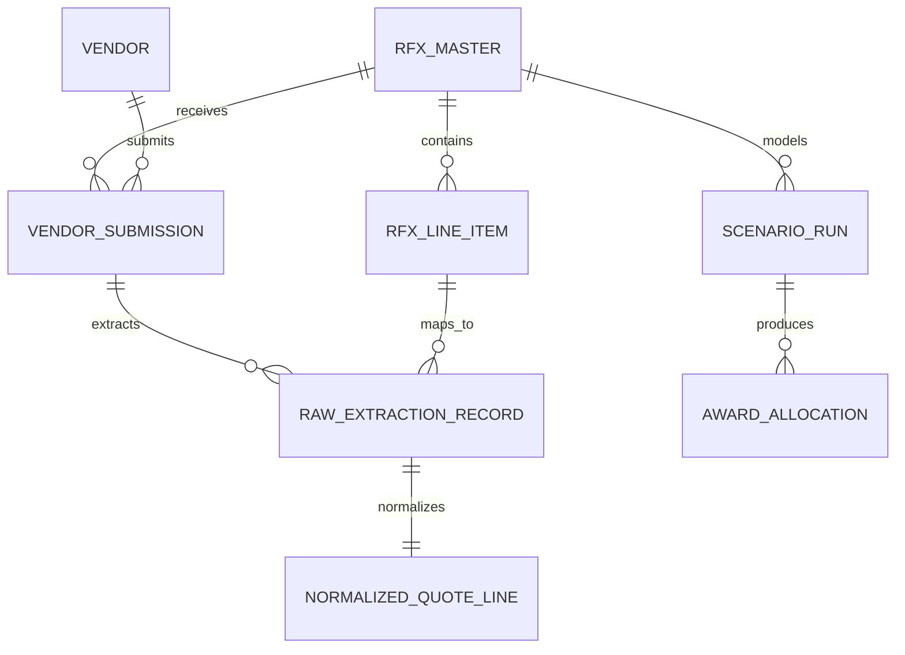

# System Architecture Document: Autonomous RFx Ingestion & Conversational Procurement Intelligence

**Product Initiative**: "Kill the Quote Spreadsheet"  
**Document Version**: 1.0.0 (Production Blueprint)  
**Target Category**: Enterprise IT Hardware & Client Compute (Laptops, Desktops, Displays, Enterprise Servers & Networking)  
**Enterprise Spend Scale Benchmark**: ₹17.90 Crore ($2.15M) Annual Direct Spend  
**Author / Role**: Lead Systems Architect & Senior Technical Product Manager  

---

## 1. Executive Architectural Overview & Design Philosophy

Direct material procurement for enterprise IT hardware is characterized by multi-format quotation chaos, non-standardized units of measure (UOM), buried commercial terms, and multi-variable scenario modeling paralysis. When ₹17.90 Crore of enterprise spend is on the line, procurement executives will never trust a generic "black-box" generative AI that hallucinates mathematical sums or misplaces commercial footnote liabilities.

This architecture is governed by five foundational design axioms:

1. **Deterministic Math, Non-Deterministic Translation**: Large Language Models (LLMs) and Vision Models are strictly restricted to *semantic extraction, spatial parsing, and intent translation*. All calculations—tax additions, unit conversions, landed cost computations, and split-award allocations—are executed by deterministic compute engines (Python, NumPy, Pandas, and Mixed-Integer Linear Programming solvers).
2. **Visual Click-to-Source Grounding (Zero Hallucination Tolerance)**: Every extracted numerical value, unit of measure, and commercial term maintains an immutable link to its raw source (bounding box on PDF/image, cell coordinates in Excel, character span in email/Word).
3. **Explicit Ambiguity Quarantine**: When extraction confidence falls below acceptable thresholds, or when data is absent (e.g., partial quotes, illegible phone photos), the system never guesses. It isolates the anomaly in an *Ambiguity Quarantine* workflow for human-in-the-loop (HITL) resolution.
4. **Constrained Mathematical Optimization over Heuristic Guessing**: Strategic "what-if" split-award scenarios are modeled as formal constraint satisfaction and Mixed-Integer Linear Programming (MILP) problems, ensuring mathematically optimal allocations that respect supplier minimum order thresholds, lead times, and quality audit hurdles.
5. **Separation of Plumbing from Core Intelligence**: As mandated by the product brief, enterprise plumbing (live SMTP/IMAP listener, SAP/Oracle ERP write-backs) is cleanly decoupled and stubbed, while multi-modal parsing, normalization mathematics, trust provenance, and conversational optimization loops are 100% production-grade.

---

## 2. End-to-End System Architecture

The platform consists of four primary operational layers: **Ingestion & Extraction**, **Deterministic Normalization**, **Conversational Intelligence & Optimization**, and **Presentation & Trust Grounding**.



---

## 3. Subsystem Breakdown & Technical Specifications

### 3.1. Subsystem A: Conversational RFx Drafting Co-Pilot
* **Objective**: Enable the Category Buyer to converse in natural language to establish the baseline RFx specification: 30 corrugated packaging SKUs, dimensional blueprints, quality inspection criteria, delivery lead times, and legal terms.
* **Architecture**:
  * **Input Parsing**: Natural language conversation or seed document ingestion (ERP item master CSV or legacy RFx).
  * **Catalog Specification Generator**: Populates standard corrugated board attributes:
    * Box Type (Regular Slotted Carton `RSC`, Die-Cut `DC`, Universal Corrugated Box `UCB`)
    * Dimensions (Internal $L \times W \times H$ in millimeters)
    * Construction ($3$-ply, $5$-ply, $7$-ply)
    * Bursting Strength ($BF \ge 16$, Bursting Factor $12$ to $24$)
    * Grammage per Square Meter ($\text{GSM} = \text{Outer Liner} + \text{Flute Medium} + \text{Inner Liner}$)
    * Target Quantities ($5,000$ to $50,000$ units per SKU)
  * **Supplier Dispatch Simulator**: Generates vendor-specific invitation packages dispatched via simulated communication channels (directory drop / mocked SMTP).

---

### 3.2. Subsystem B: Multi-Modal Ingestion & Grounded Document Extraction Pipeline

The core technical challenge is handling the **5 Heterogeneous Vendor Quotation Archetypes** without manual transcription.

```
┌──────────────────────────────────────────────────────────────────────────────────────────────────┐
│                               5 HETEROGENEOUS VENDOR SUBMISSIONS                                 │
├────────────────────┬────────────────────┬────────────────────┬──────────────────┬────────────────┤
│    VENDOR 1        │    VENDOR 2        │    VENDOR 3        │    VENDOR 4      │   VENDOR 5     │
│   Custom Excel     │  Letterhead PDF    │   Narrative Word   │  Skewed Camera   │ Casual Email   │
│   (Non-Template)   │ (Footnote Ambush)  │   (Prose Pricing)  │  Photo (Mobile)  │ (Legacy Basis) │
└────────────────────┴────────────────────┴────────────────────┴──────────────────┴────────────────┘
```

#### Detailed Architecture per Archetype:

| Vendor Archetype | Input Artifact | Failure Mode / Challenge | Technical Parsing Pipeline | Grounding Output |
| :--- | :--- | :--- | :--- | :--- |
| **Vendor 1: Apex Packaging** | Rogue `.xlsx` | Custom headers, dimensions merged (`350x250x150 mm`), 3 split tabs, taxes buried in cell subtotal formulas. | 1. `openpyxl` inspects workbook metadata and sheet names.<br>2. Sheet layout analyzer detects multi-table blocks.<br>3. Regex & AST parser splits dimensions into $L, W, H$.<br>4. Formula dependency graph isolates base rates from taxes. | Sheet Name + Exact Cell Coordinates (e.g., `Shipper Boxes!D14:E14`) |
| **Vendor 2: CorruPack India** | Multi-Page PDF | 4-page formal letterhead; main table shows ex-works rate; 7pt Footnote #3 contains 4.5% turnover rebate, 8% freight handling, and 18% GST. | 1. `pdfplumber` / `PyMuPDF` extracts high-density tables and spatial text blocks.<br>2. Vision LLM executes layout-aware semantic scan to bind footnotes to relevant pricing rows.<br>3. Footnote conditional rules are parsed into structured modifiers. | Page Number + Bounding Box Normalized Coordinates `[ymin, xmin, ymax, xmax]` |
| **Vendor 3: National Boxes** | Microsoft Word (`.docx`) | Unstructured narrative prose: *"Items 1-10 @ ₹48.50 for 5,000+ units; <2,000 unit surcharge of ₹3.20/pc; 10-day lead time."* | 1. `python-docx` extracts raw XML DOM and paragraph runs.<br>2. LLM Information Extractor maps SKU ranges to tiered pricing models.<br>3. Extracts lead-time metadata into supplier qualification matrix. | Paragraph Index + Exact Character Span Offset |
| **Vendor 4: Vardhman Paper Mills** | Skewed Camera Photo (`.jpeg`) | 2D perspective distortion, shadow gradient across right edge, handwritten blue ink corrections, only 27 of 30 lines quoted (incomplete bid). | 1. OpenCV Preprocessor: Hough transform, corner detection, quadrilateral perspective warp, adaptive histogram equalization (CLAHE).<br>2. Multi-modal Vision LLM extracts handwriting and printed grids.<br>3. Sparse Matrix detector flags 3 missing lines. | Image Normalized Polygon Coordinates + Visual Cropped Overlay |
| **Vendor 5: Shree Balaji Pack** | Plain-Text Email (`.eml` / `.txt`) | Sales director shorthand: *"₹42/kg 5-ply, ₹38.50/kg 3-ply, rest same as 2025 contract + 3.5% escalation, DDP Bhiwandi."* | 1. Email body parser isolates commercial statements.<br>2. Historical contract resolver pulls 2025 baseline prices and applies 3.5% multiplier.<br>3. Dimensional Board Weight Engine converts ₹/kg into ₹/box. | Email Message Body Character Line & Byte Range |

---

### 3.3. Subsystem C: Deterministic Normalization & True Landed Cost (TCO) Engine

Raw vendor quotations cannot be compared directly without rigorous mathematical transformations.



#### 1. Corrugated Packaging Dimensional Board Weight Formula
To convert Vendor 5's rate quoted in **₹ / kg** into an apples-to-apples **₹ / piece** rate, the physical weight of each corrugated box must be deterministically calculated:

$$\text{Surface Area } (m^2) = \frac{2 \times (L + W) \times (W + H) + \text{Flap Allowance}}{10^6}$$

$$\text{Theoretical Board Weight } (g) = \text{Surface Area } (m^2) \times \left( \sum_{i=1}^{\text{Plies}} \text{GSM}_i \times \text{TakeUpFactor}_i \right) \times (1 + \text{Moisture Factor})$$

*Where:*
* $\text{TakeUpFactor} \approx 1.45$ for Flute B, $1.35$ for Flute C.
* $\text{Moisture Factor} \approx 0.05$ (5% standard moisture content).

$$\text{Unit Base Price } (\text{INR/piece}) = \left(\frac{\text{Theoretical Board Weight } (g)}{1000}\right) \times \text{Quoted Rate } (\text{INR/kg})$$

#### 2. True Landed Cost (TCO) Formula
$$\text{Landed Cost per Unit} = \text{Base Price} - \text{Volume Rebate} + \text{Freight} + \text{Transit Insurance} + \text{Unrecoverable Taxes} + \frac{\text{Tooling & Stereo Charges}}{\text{Amortized Volume}}$$

* **Ex-Works vs. DDP Normalization**:
  * If quoted **Ex-Works** (e.g., Vendor 2): System adds freight distance matrix cost (e.g., ₹2.80/box) + 8% handling + 0.35% transit insurance.
  * If quoted **DDP** (e.g., Vendor 5): Freight and insurance are already embedded; additional handling is set to ₹0.
* **Volume Rebate Unbundling**:
  * Vendor 2's Footnote #3 (4.5% annual turnover rebate on spend > ₹1.5 Cr) is evaluated against total RFx category spend projection. If annual volume crosses ₹1.5 Cr, a 4.5% credit is deducted from the landed cost.

#### 3. Handling Sparse Matrices & Partial Bids (Vendor 4)
* Vendor 4 bids on only 27 of 30 lines.
* **Single-Source Modeling**: Vendor 4 is disqualified from single-source award simulation with an explicit UI status badge: `INCOMPLETE BID (27/30 Lines)`.
* **Split-Award Modeling**: Vendor 4 is evaluated strictly for the 27 lines submitted; the remaining 3 lines are allocated to alternative qualified vendors without breaking calculation loops.

---

### 3.4. Subsystem D: The "Trust & Provenance" Subsystem (₹4-Crore Enterprise Threshold)

When enterprise buyers risk ₹4.0 Crore of capital, trust is not an afterthought—it is the core architectural requirement.

```
┌────────────────────────────────────────────────────────────────────────────────────────┐
│                          THE ENTERPRISE TRUST ARCHITECTURE                             │
├────────────────────────────────────────────────────────────────────────────────────────┤
│  1. CLICK-TO-SOURCE VISUAL GROUNDING                                                   │
│     Hovering or clicking any rate highlights the physical source bounding box.        │
│                                                                                        │
│  2. AMBIGUITY QUARANTINE PIPELINE                                                      │
│     Low-confidence (<85%) extractions are quarantined before entering matrix.          │
│                                                                                        │
│  3. DETERMINISTIC AUDIT LOG (IMMUTABILITY)                                             │
│     All manual buyer adjustments preserve original raw value + buyer override note.   │
│                                                                                        │
│  4. COMPLETE RECONCILIATION PROOF                                                      │
│     Total Spend = Sum(Allocated Line Items) + Amortized Tooling + Net Surcharges.      │
└────────────────────────────────────────────────────────────────────────────────────────┘
```

#### Grounding Coordinate Architecture:
Every cell in the master comparison table carries a `ProvenanceMetadata` payload:

```json
{
  "cell_id": "quote_v2_line14",
  "vendor_id": "vendor_corrupack_02",
  "sku_code": "SKU-BOX-5PLY-014",
  "normalized_landed_cost_inr": 46.85,
  "raw_value": "42.00",
  "raw_currency": "INR",
  "raw_uom": "piece",
  "confidence_score": 0.985,
  "provenance": {
    "source_file": "CorruPack_Commercial_Quote.pdf",
    "page_index": 2,
    "bounding_box": {
      "ymin": 0.452,
      "xmin": 0.120,
      "ymax": 0.478,
      "xmax": 0.380
    },
    "footnote_reference": {
      "footnote_id": "FN-3",
      "page_index": 4,
      "text": "Prices subject to a retrospective 4.5% turnover rebate...",
      "bounding_box": {
        "ymin": 0.880,
        "xmin": 0.095,
        "ymax": 0.925,
        "xmax": 0.850
      }
    }
  },
  "audit_trail": {
    "normalization_formula": "Base(42.00) - Rebate(1.89) + Freight(4.50) + Ins(0.14) + Tooling(2.10)",
    "verified_by_human": false
  }
}
```

---

### 3.5. Subsystem E: Conversational Strategic Scenario & Constrained Optimization Engine

Procurement executives do not ask simple lookup queries; they ask complex, multi-variable strategic scenario questions:

> *"What if we split the award across the cheapest qualified suppliers who passed quality audits and can deliver in under 12 days, while ensuring no vendor gets awarded less than ₹5 Lakhs so we don't trigger small-order surcharges?"*

#### Why LLMs Cannot Do This Directly:
For 30 line items across 5 vendors with qualitative constraints and minimum order thresholds, the combination space is $5^{30} \approx 9.3 \times 10^{20}$. An LLM attempting to answer this in natural language will produce hallucinated sums, miscalculate line assignments, or violate the ₹5 Lakh threshold.

#### Technical Implementation: Mixed-Integer Linear Programming (MILP)



#### Formal Mathematical Optimization Model:

* **Sets**:
  * $I = \{1, 2, \dots, 30\}$ : Set of RFx packaging line items.
  * $V = \{1, 2, 3, 4, 5\}$ : Set of bidding vendors.
* **Parameters**:
  * $D_i$ : Demand quantity for item $i$.
  * $C_{iv}$ : Landed cost per unit of item $i$ from vendor $v$.
  * $Q_v \in \{0, 1\}$ : Audit qualification flag for vendor $v$ ($1$ if passed, $0$ if failed).
  * $L_v$ : Quoted delivery lead time (days) for vendor $v$.
  * $L_{\max}$ : Maximum permissible lead time threshold (e.g., $12$ days).
  * $M$ : Minimum spend allocation threshold per awarded vendor (₹$5,00,000$).
  * $B_{iv} \in \{0, 1\}$ : Bid completeness indicator ($1$ if vendor $v$ bid on item $i$, $0$ otherwise).
* **Decision Variables**:
  * $x_{iv} \in \{0, 1\}$ : Binary decision variable; $1$ if line item $i$ is awarded to vendor $v$, $0$ otherwise.
  * $y_v \in \{0, 1\}$ : Indicator variable; $1$ if vendor $v$ is awarded any spend, $0$ otherwise.

* **Objective Function**:
  $$\min \sum_{i \in I} \sum_{v \in V} D_i \cdot C_{iv} \cdot x_{iv}$$

* **Subject to Constraints**:
  1. **Single-Source SKU Fulfillment**: Every line item must be assigned to exactly one vendor:
     $$\sum_{v \in V} x_{iv} = 1 \quad \forall i \in I$$
  2. **Bid Completeness Constraint**: Line items can only be awarded if a valid bid exists:
     $$x_{iv} \le B_{iv} \quad \forall i \in I, \forall v \in V$$
  3. **Quality & Compliance Hurdle**:
     $$x_{iv} \le Q_v \quad \forall i \in I, \forall v \in V$$
  4. **Lead Time Constraint**:
     $$x_{iv} = 0 \quad \text{if } L_v > L_{\max}, \quad \forall i \in I, \forall v \in V$$
  5. **Vendor Activation Constraint (Linking $x_{iv}$ and $y_v$)**:
     $$x_{iv} \le y_v \quad \forall i \in I, \forall v \in V$$
  6. **Minimum Spend Threshold per Active Vendor (₹5 Lakhs)**:
     $$\sum_{i \in I} D_i \cdot C_{iv} \cdot x_{iv} \ge M \cdot y_v \quad \forall v \in V$$

---

## 4. Comprehensive Data Models & Database Schemas

The database schema is implemented in SQLite (for lightweight local execution) or PostgreSQL (for multi-tenant production).



### 4.1. Table: `rfx_master`
| Field | Type | Description |
| :--- | :--- | :--- |
| `rfx_id` | `VARCHAR(36)` (PK) | Unique UUID for RFx event |
| `title` | `VARCHAR(255)` | Event Title (e.g., "Annual Corrugated Packaging FY26-27") |
| `category` | `VARCHAR(100)` | Sourcing category (`Packaging_Corrugated`) |
| `target_spend_inr` | `DECIMAL(14, 2)` | Baseline spend benchmark (e.g., ₹40,000,000.00) |
| `currency` | `VARCHAR(3)` | Base reporting currency (`INR`) |
| `status` | `VARCHAR(50)` | `DRAFT`, `DISPATCHED`, `INGESTED`, `EVALUATED`, `AWARDED` |
| `created_at` | `TIMESTAMP` | Timestamp of creation |

### 4.2. Table: `rfx_line_item`
| Field | Type | Description |
| :--- | :--- | :--- |
| `item_id` | `VARCHAR(36)` (PK) | SKU UUID |
| `rfx_id` | `VARCHAR(36)` (FK) | Reference to `rfx_master` |
| `sku_code` | `VARCHAR(100)` | Buyer SKU Code (e.g., `SKU-BOX-RSC-001`) |
| `description` | `TEXT` | Full technical specification description |
| `length_mm` | `INTEGER` | Box outer length in mm |
| `width_mm` | `INTEGER` | Box outer width in mm |
| `height_mm` | `INTEGER` | Box outer height in mm |
| `ply_count` | `INTEGER` | Corrugated plies ($3$, $5$, or $7$) |
| `burst_factor` | `DECIMAL(5, 2)` | Bursting factor requirement |
| `gsm_spec` | `VARCHAR(100)` | Composition (e.g., `180/120/120/120/180`) |
| `board_weight_grams` | `DECIMAL(8, 2)` | Theoretical calculated box weight in grams |
| `annual_quantity` | `INTEGER` | Projected annual demand units |
| `target_uom` | `VARCHAR(20)` | Normalized comparison unit (`PIECE`) |

### 4.3. Table: `vendor`
| Field | Type | Description |
| :--- | :--- | :--- |
| `vendor_id` | `VARCHAR(36)` (PK) | Vendor UUID |
| `vendor_name` | `VARCHAR(255)` | Legal entity name (e.g., "CorruPack India Ltd.") |
| `qualification_passed`| `BOOLEAN` | Quality questionnaire audit clearance status |
| `quality_score` | `DECIMAL(5, 2)` | Audit score (0.00 to 100.00) |
| `quoted_lead_time_days`| `INTEGER` | Quoted delivery turnaround time |
| `payment_terms` | `VARCHAR(100)` | Agreed commercial terms (e.g., "Net 60 Days") |

### 4.4. Table: `vendor_submission`
| Field | Type | Description |
| :--- | :--- | :--- |
| `submission_id` | `VARCHAR(36)` (PK) | Unique submission UUID |
| `rfx_id` | `VARCHAR(36)` (FK) | Reference to `rfx_master` |
| `vendor_id` | `VARCHAR(36)` (FK) | Reference to `vendor` |
| `file_path` | `VARCHAR(500)` | Local/S3 storage file path |
| `file_type` | `VARCHAR(50)` | `XLSX`, `PDF`, `DOCX`, `JPEG`, `EMAIL_TXT` |
| `submission_hash` | `VARCHAR(64)` | SHA256 integrity hash of raw file |
| `ingested_at` | `TIMESTAMP` | Ingestion timestamp |

### 4.5. Table: `normalized_quote_line`
| Field | Type | Description |
| :--- | :--- | :--- |
| `quote_line_id` | `VARCHAR(36)` (PK) | Line UUID |
| `submission_id` | `VARCHAR(36)` (FK) | Reference to `vendor_submission` |
| `item_id` | `VARCHAR(36)` (FK) | Reference to `rfx_line_item` |
| `raw_quoted_price` | `DECIMAL(12, 4)` | As-quoted price in vendor's original currency/UOM |
| `raw_currency` | `VARCHAR(3)` | `INR`, `USD`, etc. |
| `raw_uom` | `VARCHAR(50)` | `piece`, `kg`, `100 units`, `1000 units` |
| `normalized_base_price_inr` | `DECIMAL(12, 4)` | Base price converted to INR per Piece |
| `freight_per_unit_inr` | `DECIMAL(10, 4)` | Freight charge per unit |
| `insurance_per_unit_inr` | `DECIMAL(10, 4)` | Transit insurance per unit |
| `rebate_per_unit_inr` | `DECIMAL(10, 4)` | Amortized volume discount per unit |
| `tax_per_unit_inr` | `DECIMAL(10, 4)` | Unrecoverable tax per unit |
| `landed_cost_unit_inr` | `DECIMAL(12, 4)` | Computed true landed cost per unit |
| `is_bid_present` | `BOOLEAN` | `TRUE` if quoted, `FALSE` if omitted |
| `confidence_score` | `DECIMAL(4, 3)` | Extraction confidence score ($0.000$ to $1.000$) |
| `provenance_json` | `JSON` | Bounding box coordinates, page index, and cell metadata |
| `is_quarantined` | `BOOLEAN` | Flagged if confidence < 0.85 or ambiguity detected |
| `quarantine_reason` | `VARCHAR(255)` | Reason for quarantine (e.g., "Illegible ballpoint edit") |

---

## 5. User Interface & Interaction Architecture

The interface is engineered specifically for Senior Direct Sourcing Category Buyers, reflecting the production layout observed in Aerchain's official platform demo video (`frame_072s.png`), emphasizing information density, audit traceability, and interactive split-award scenario manipulation.

```
┌────────────────────────────────────────────────────────────────────────────────────────────────────────────────────────┐
│  AERCHAIN   Module ▼   Purchase order ▼   Invoices   Budgets ▼                             [Aera • Active]  (Will Router)  │
│  Breadcrumb: RFQ-FY26-PKG-014 > Quote Analysis > Quoted                                                                │
├────────────────────────────────────────────────────────────────────────────────────────────────────────────────────────┤
│  Quote Analysis                           Feedback Setting: ■ Outlier  ■ Slightly High  ■ High  ■ Very High   [Award]   │
│  Scenario: [VP Constrained Split ▼]       Net Saving: [₹58.8 L | +14.7% 🟢]    Awarded Suppliers: 3                    │
├────────────────────────────────────────────────────────────────────────────────────────────────────────────────────────┤
│ ┌─ LEFT PANE: AERA COPILOT (35%) ──────────────┐ ┌─ RIGHT PANE: MASTER COMPARISON MATRIX (65%) ──────────────────────┐ │
│ │ • Prompt Quick-Chips:                        │ │ S.No | SKU Code    | Qty    | Baseline | TP     | Apex | CorruPack... │ │
│ │   [Cheapest Line-by-Line]                    │ │ ─────┼─────────────┼────────┼──────────┼────────┼──────┼───────────── │ │
│ │   [Split Award: Quality Pass & Lead <= 12d]  │ │ 1    | SKU-BOX-001 | 25,000 | ₹45.00   | ₹38.00 |₹41.20| ₹39.80* 🟢  │ │
│ │   [Min Order >= ₹5L per Vendor]              │ │ 2    | SKU-BOX-002 | 10,000 | ₹62.00   | ₹52.00 |₹58.00| ₹54.20* 🟢  │ │
│ │                                              │ │ ...  | (30 SKUs)   | ...    | ...      | ...    | ...  | ...          │ │
│ │ 🤖 Aera Optimization Result:                 │ │ ─────┴─────────────┴────────┴──────────┴────────┴──────┴───────────── │ │
│ │ • Total Spend: ₹3,41,20,000                  │ │ Commercial Terms Footer:                                              │ │
│ │ • Net Savings: ₹58,80,000 (14.7%)            │ │ Sub-Total        | ₹4.00 Cr | ₹3.60 Cr | ₹3.82 Cr | ₹3.41 Cr ... │ │
│ │ • Allocation: CorruPack (18), National (9),  │ │ Total Taxes (GST)| 18%      | 18%      | Extra  | Included ...    │ │
│ │   Balaji (3)                                 │ │ Payment Terms    | Net 30   | Net 30   | Net 30 | Net 60 ...      │ │
│ │                                              │ │ Lead Time (Days) | 10       | 10       | 15     | 9 ...           │ │
│ │ [Apply Allocation to Matrix]                 │ ├───────────────────────────────────────────────────────────────────────┤ │
│ │ [Export Board Award Decision Memo]           │ │ 📁 QUESTIONNAIRE COMPARISON (Directly beneath pricing rows)           │ │
│ └──────────────────────────────────────────────┘ │ │ ISO 9001 Certified? | Passed    | Passed   | Audit Failed (Vendor 1)│ │
│                                                  └───────────────────────────────────────────────────────────────────────┘ │
└────────────────────────────────────────────────────────────────────────────────────────────────────────────────────────┘
```

### 5.1. UI Components & Layout Specifications:
1. **Master "Quote Analysis" Grid (TanStack Table v8)**:
   * Displays all 30 SKUs with `Baseline` (historical reference price) and `TP` (Target Price) anchors.
   * Visual indicators: Emerald green highlight for lowest landed cost; Pink/Red highlight for high rates; Amber badge for quarantined rates.
   * Commercial terms footer rows: `Sub-Total`, `Total Taxes`, `Freight / TCO Adjustments`, `Payment Terms`, and `Lead Time`.
2. **Integrated Questionnaire Comparison Sub-Grid**:
   * Positioned directly beneath the commercial pricing rows, presenting qualitative supplier audit responses (ISO 9001 certification, ESG score, historical defect rate, plant capacity) side-by-side.
3. **Click-to-Source Grounding Drawer**:
   * Clicking any cell in the table slides out the raw source document viewer.
   * High-resolution visual canvas highlights the exact bounding box (on PDFs, JPEGs) or sheet cell (on Excel) with a side-by-side formula inspector.
4. **Ambiguity Quarantine Review Drawer**:
   * Surfaces low-confidence extractions, missing line items (Vendor 4's 3 unquoted items), and ambiguous commercial clauses.
   * Enables one-click buyer validation, manual override, or clarification request generation.
5. **Conversational Scenario Sidebar (Aera)**:
   * Dual-pane chat interface integrated with real-time text-to-optimization compiler and clickable suggestion pills (`[Lowest Landed Cost]`, `[Split Award: Quality Pass & Lead Time <= 12d]`, `[Min Order >= ₹5L]`).
   * Dynamic scenario cards outputting total spend, net hard-cash savings, and supplier allocation splits.

---

## 6. Complete Technology Stack & Architecture Decisions

| Tier | Component / Tool | Justification & Architectural Role |
| :--- | :--- | :--- |
| **Frontend Framework** | **Next.js 14 (App Router) + React** | Server-side rendering for speed, reactive state management, high performance for enterprise data grids. |
| **Styling & Components**| **Tailwind CSS + Shadcn UI** | Clean, accessible, production-grade enterprise design system. |
| **Grid Engine** | **TanStack Table v8** | High-performance virtualized table rendering capable of smoothly displaying 30 SKUs $\times$ 5 vendors $\times$ 25 commercial attributes. |
| **Document Canvas** | **React-PDF / PDF.js + Canvas Bounding Overlay** | Real-time visual rendering of source PDFs and JPEGs with coordinate-driven bounding box overlays. |
| **Backend API** | **FastAPI (Python 3.11+)** | High-throughput async framework with strict Pydantic v2 validation schemas. |
| **In-Memory Analytical DB**| **DuckDB / SQLite** | High-speed analytical queries, SQL aggregation, and local columnar storage without heavy external DB infrastructure. |
| **Vision & Extraction LLM** | **Gemini 1.5 Pro / GPT-4o Multi-modal** | State-of-the-art spatial document comprehension, layout parsing, and fine-print footnote extraction. |
| **Computer Vision Engine** | **OpenCV (cv2) + Pillow** | Image pre-processing: Perspective correction, de-skewing, contrast normalization for mobile photos (Vendor 4). |
| **Spreadsheet & Doc Parsers**| **openpyxl, python-docx, PyMuPDF** | Pure deterministic AST parsers for extracting raw tables, paragraphs, and formulas before semantic processing. |
| **Optimization Solver** | **PuLP / Google OR-Tools** | Industry-standard Mixed-Integer Linear Programming (MILP) solver for deterministic split-award optimization under hard constraints. |
| **Audit Exporter** | **ReportLab / WeasyPrint + openpyxl** | Generates defensible, branded Executive Award Decision Memos (PDF) and consolidated Excel workbooks. |

---

## 7. System Boundaries: Deliberate Stubs vs. Real AI Loops

To satisfy the take-home requirements with zero artificiality, system boundaries are strictly demarcated:

```
┌────────────────────────────────────────────────────────────────────────────────────────────────────────┐
│                                 DELIBERATE STUBS VS. REAL CORE LOOPS                                   │
├─────────────────────────────────────────────────┬──────────────────────────────────────────────────────┤
│  REAL PRODUCTION LOOPS (100% UNFAKED)           │  DELIBERATELY STUBBED (PLUMBING)                     │
├─────────────────────────────────────────────────┼──────────────────────────────────────────────────────┤
│  ✔ Multi-modal parsing of all 5 raw messy files │  ✖ Live SMTP / IMAP Email Server:                    │
│    (Angled photo, footnote PDF, non-template    │    Replaced by a simulated folder listener/uploader. │
│    Excel, prose Word doc, casual email).        │                                                      │
│  ✔ Computer Vision perspective de-skewing.     │  ✖ ERP Two-Way Write-Back (SAP / Oracle BAPI):       │
│  ✔ Formula-driven physical board weight math.   │    Replaced by clean standard JSON & Excel export.   │
│  ✔ True Landed Cost (TCO) normalization engine. │                                                      │
│  ✔ Real-time MILP constraint optimization.      │  ✖ Complex Multi-Tenant RBAC & SSO:                 │
│  ✔ Click-to-source spatial coordinate grounding.│    Assumes active authenticated Senior Buyer session.│
│  ✔ Real-time text-to-optimization translation.  │                                                      │
└─────────────────────────────────────────────────┴──────────────────────────────────────────────────────┘
```

---

## 8. Edge Cases, Failure Modes & Graceful Degradation

Enterprise procurement is rife with edge-case exceptions. The system handles them as first-class architectural states:

### 1. The Angled, Distorted Mobile Photo (Vendor 4)
* **Failure Mode**: Optical distortion, glare, shadows, and handwritten corrections cause standard OCR to misread numbers (e.g., reading ₹38 as ₹88).
* **Mitigation**:
  1. OpenCV applies four-point perspective transformation to flatten the image into a canonical rectangular plane.
  2. Multi-modal vision model outputs character-level confidence scores.
  3. Any cell with confidence $< 0.85$ is flagged with an orange warning indicator and placed in the Ambiguity Quarantine drawer for immediate visual confirmation.

### 2. The Incomplete / Sparse Bid (Vendor 4's 27/30 Lines)
* **Failure Mode**: Summing total spend across vendors breaks or unfairly favors Vendor 4 because 3 lines are missing.
* **Mitigation**:
  * In single-source scenario evaluation, Vendor 4 is explicitly tagged as `DISQUALIFIED (Incomplete Bid)`.
  * In split-award optimization, binary indicator variables $B_{iv} = 0$ ensure the solver never assigns missing lines to Vendor 4, while allowing them to win any of the 27 lines where they are most competitive.

### 3. Conflicting Contractual Terms
* **Failure Mode**: Vendor email claims "Net 30 Days Credit", but attached formal proposal states "100% Advance Payment".
* **Mitigation**:
  * The ingestion engine flags commercial clause contradictions between document body and attachment as an `INTER-DOCUMENT CONFLICT`.
  * The buyer is alerted via an inline warning prompt to designate the governing legal instrument.

### 4. Mathematical Constraint Infeasibility
* **Failure Mode**: Buyer requests a scenario where no supplier gets less than ₹5 Lakhs, but only suppliers with $< 7$ days lead time qualify, making it mathematically impossible to fulfill all 30 lines.
* **Mitigation**:
  * The MILP solver detects infeasibility (`LpStatusInfeasible`).
  * Rather than crashing, the conversational analyst returns a natural language diagnosis:
    > *"Scenario Infeasible: Restricting lead time to $\le 7$ days leaves 4 SKUs without any eligible supplier. Would you like to relax the lead-time threshold to 10 days, or allow an exemption for Vendor 2?"*

---

## 9. Live Demo Execution & Walkthrough Runbook

This architecture is built to drive a live evaluation demonstration proving every capability required by the assessment brief:

```mermaid
journey
    title Live Evaluation Demo Flow: "Kill the Quote Spreadsheet"
    section 1. RFx Inception
      Buyer drafts packaging RFx with AI Co-Pilot: 5: Buyer
      System seeds 30 corrugated packaging SKUs: 5: System
    section 2. Multi-Modal Ingestion
      Ingest messy files (Excel, PDF, Word, JPEG, Email): 5: System
      OpenCV de-skews phone photo; Vision LLM extracts footnotes: 5: System
    section 3. Unified Comparison
      Deterministic math converts ₹/kg and USD to landed ₹/piece: 5: System
      Render 30 SKU side-by-side comparison matrix: 5: UI
    section 4. Trust Grounding
      Buyer clicks cell; system opens PDF bounding box: 5: Buyer, UI
      Buyer reviews Ambiguity Quarantine for phone photo: 5: Buyer
    section 5. Conversational Scenarios
      Buyer prompts: "Split award: lowest landed cost, quality audited, lead time <= 12 days, min ₹5L": 5: Buyer
      MILP solver computes optimal split & ₹58.8L savings: 5: System
    section 6. Award Decision
      Export defensible Board Award Decision Memo: 5: System
```

### Scripted Demo Steps:
1. **RFx Setup**: Display the 30 industrial packaging SKUs with technical parameters (flutes, burst factors, GSM, dimensions).
2. **Batch Ingestion of 5 Chaotic Vendor Files**:
   * Drag-and-drop the 5 vendor files simultaneously into the ingestion pane.
   * Watch live status badges update as parsers execute extraction, spatial coordinate mapping, and normalization.
3. **Inspect Normalized Matrix**:
   * Review all 30 SKUs aligned on the exact same basis (₹ / piece Landed Cost).
   * Observe how Vendor 5's ₹/kg quotes have been converted to ₹/piece via dimensional board weight.
   * Observe Vendor 2's landed rate incorporating Footnote #3's 4.5% rebate and freight charges.
4. **Prove Click-to-Source Grounding**:
   * Click on Vendor 2's rate for SKU-014; verify that the PDF viewer instantly jumps to Page 2, draws a highlighted rectangle around cell D14, and references Footnote #3 on Page 4.
5. **Run the Executive Scenario**:
   * In the conversational analyst box, input the VP's exact question:
     > *"Split the award across the cheapest qualified suppliers who passed quality audits and can deliver in under 12 days, ensuring no vendor receives less than ₹5 Lakhs."*
   * Observe the MILP solver calculate the multi-supplier award allocation in $< 800$ ms.
   * Review the breakdown: Total Spend, Net Savings vs. Baseline, and Supplier Allocation Chart.
6. **Generate Decision Memo**:
   * Click **Generate Award Decision Memo** to produce an audit-ready, defensible executive summary ready for CPO signature.

---

*This architectural blueprint serves as the definitive technical standard for the Aerchain "Kill the Quote Spreadsheet" platform.*
