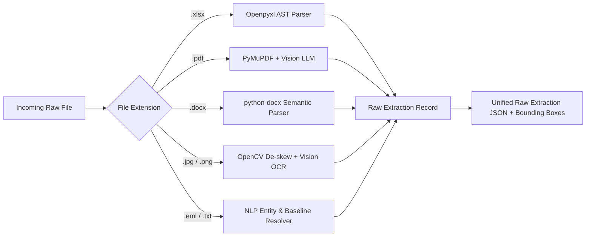

# Implementation Plan: Autonomous RFx Ingestion & Conversational Procurement Intelligence

**Product Initiative**: "Kill the Quote Spreadsheet"  
**Platform Architecture**: Aerchain Multi-Agent Ecosystem (**Aera AI + Evaluation Agent + Omnichannel Hub**)  
**Role**: Senior Technical Product Manager & Systems Architect  
**Target Category (MVP Reference Pack)**: Enterprise IT Hardware & Client Compute (Laptops, Desktops, Displays, Enterprise Servers & Networking)  
**Spend Scale Benchmark**: ₹17.90 Crore ($2.15M) Annual Direct Spend across 30 SKUs & 5 Heterogeneous Suppliers  
**Reference Documents**: [problem_statement.md](file:///h:/Antigravity/Aerchain/problem_statement.md) | [architecture.md](file:///h:/Antigravity/Aerchain/architecture.md)  
**Document Status**: Phased Execution Blueprint (Version 1.0)

---

## 1. Executive Implementation Strategy & Roadmap

This document outlines the **phase-by-phase engineering execution plan** to build, verify, and demo the "Kill the Quote Spreadsheet" platform. 

### The Core Architectural Principles Governing Implementation:
1. **The Wedge Strategy**: We implement a deep, mathematically rigorous vertical for **Enterprise IT Hardware & Client Compute** (with OEM warranty terms, imaging surcharges, volume turnover rebates, and tech center logistics) rather than a shallow, generic horizontal tool.
2. **Deterministic Math, Non-Deterministic Translation**: LLMs handle semantic extraction and intent translation; Python, DuckDB, and an embedded Mixed-Integer Linear Programming (MILP) solver execute all mathematical calculations and scenario optimizations.
3. **Aerchain Production Layout**: The user interface directly reflects Aerchain’s dual-pane layout (**Aera Copilot on the left**, **Quote Analysis Master Matrix on the right**, and **Questionnaire Comparison sub-grid below**).
4. **Zero-Faked AI Loops**: We stub enterprise plumbing (simulated file directory instead of live SMTP, standard exports instead of live SAP BAPIs), but keep document extraction, OpenCV image processing, landed cost math, and MILP optimization 100% real.

```
┌──────────────────────────────────────────────────────────────────────────────────────────────────┐
│                               PHASE-WISE IMPLEMENTATION TIMELINE                                 │
├─────────┬────────────────────────────────────────────────────────┬───────────────────────────────┤
│ Phase   │ Focus Area                                             │ Key Deliverable               │
├─────────┼────────────────────────────────────────────────────────┼───────────────────────────────┤
│ Phase 0 │ Project Scaffolding & Environment Setup                │ Monorepo, APIs, Schema Models │
│ Phase 1 │ Realistic Procurement Dataset Generation (30 SKUs)     │ 5 Real Chaotic Vendor Files   │
│ Phase 2 │ Multi-Modal Ingestion Pipeline (Omnichannel Hub)       │ OpenCV, PDF, Excel Parsers    │
│ Phase 3 │ Deterministic Normalization & Landed Cost Engine       │ Physical Board Weight Math    │
│ Phase 4 │ Conversational Intent Parser & MILP Optimizer (Aera)   │ PuLP Split-Award Engine       │
│ Phase 5 │ Dual-Pane Interface & Trust Grounding (Presentation)   │ TanStack Grid, Bounding Box   │
│ Phase 6 │ Defensive Audit Exporter (Board Award Memo)            │ Audit-Ready PDF / Excel Memo  │
│ Phase 7 │ End-to-End Verification & Live Demo Runbook            │ Zero-Failure Demo Script      │
└─────────┴────────────────────────────────────────────────────────┴───────────────────────────────┘
```

---

## Phase 0: Project Scaffolding & Environment Setup

### Objective
Establish the repository structure, install dependencies, configure backend APIs, database schemas, and initialize the frontend application.

### Technical Stack & Dependencies:
* **Frontend**: Next.js 14 (App Router), React 18, TypeScript, Tailwind CSS, Lucide React, TanStack Table v8, Shadcn UI components.
* **Backend**: FastAPI (Python 3.11+), Pydantic v2, Uvicorn, DuckDB / SQLite.
* **Analytical & Mathematical Engine**: NumPy, Pandas, PuLP (Linear Programming Solver).
* **Document Processing & Vision**: PyMuPDF (`fitz`), `pdfplumber`, `openpyxl`, `python-docx`, OpenCV (`opencv-python-headless`), Pillow (`PIL`).
* **Multi-Modal AI Integration**: Google Gemini 1.5 Pro / Flash Multi-modal API SDK.

### Directory Structure Blueprint:
```
h:\Antigravity\Aerchain\
├── backend/
│   ├── app/
│   │   ├── api/
│   │   │   ├── rfx_routes.py          # RFx creation & listing
│   │   │   ├── ingestion_routes.py    # File upload & extraction status
│   │   │   ├── matrix_routes.py       # Normalized comparison matrix
│   │   │   ├── scenario_routes.py     # MILP optimization runs
│   │   │   └── export_routes.py       # Award Memo PDF/Excel export
│   │   ├── core/
│   │   │   ├── config.py              # Environment variables & paths
│   │   │   └── database.py            # SQLite / DuckDB session
│   │   ├── models/
│   │   │   └── schemas.py             # Pydantic models & DB tables
│   │   ├── services/
│   │   │   ├── parsers/               # Multi-modal file extractors
│   │   │   │   ├── excel_parser.py    # Vendor 1: Multi-tab openpyxl
│   │   │   │   ├── pdf_parser.py      # Vendor 2: PyMuPDF + footnote binding
│   │   │   │   ├── docx_parser.py     # Vendor 3: python-docx narrative prose
│   │   │   │   ├── vision_parser.py   # Vendor 4: OpenCV de-skew + OCR
│   │   │   │   └── email_parser.py    # Vendor 5: Shorthand email + contract base
│   │   │   ├── normalizer.py          # Landed cost & packaging board weight
│   │   │   ├── optimizer.py           # PuLP Mixed-Integer Linear Programming
│   │   │   └── memo_generator.py      # Audit report generator
│   │   └── main.py                    # FastAPI application entrypoint
│   └── requirements.txt
├── frontend/
│   ├── src/
│   │   ├── components/
│   │   │   ├── AeraCopilot.tsx        # Left pane: Conversational assistant & prompt chips
│   │   │   ├── QuoteAnalysisTable.tsx # Right pane: TanStack master matrix
│   │   │   ├── QuestionnaireGrid.tsx  # Bottom sub-grid: Qualitative supplier audits
│   │   │   ├── SourceViewerDrawer.tsx # Slide-out: Bounding box visual grounding
│   │   │   ├── QuarantineDrawer.tsx   # Ambiguity review & HITL override
│   │   │   └── ScenarioMetricsBar.tsx # Header: Best Quote, Net Savings, Award button
│   │   ├── app/
│   │   │   ├── layout.tsx
│   │   │   └── page.tsx               # Main dual-pane cockpit
│   │   └── types/
│   │       └── procurement.ts         # TypeScript interfaces
│   └── package.json
├── dataset/                           # Raw synthetic chaotic vendor artifacts
│   ├── rfx_spec_30_skus.json          # Master RFx item catalog (Corrugated Packaging)
│   ├── vendor_1_apex_quote.xlsx       # Rogue Excel with merged dims & 3 tabs
│   ├── vendor_2_corrupack_quote.pdf   # 4-page PDF with 7pt Footnote #3 rebate
│   ├── vendor_3_national_quote.docx   # Word narrative proposal
│   ├── vendor_4_vardhman_quote.jpg    # Angled phone photo (27/30 items)
│   ├── vendor_5_balaji_quote.eml      # Plain text shorthand email (₹42/kg)
│   └── vendor_qualifications.json     # ISO 9001, lead times, defect rates
└── documentation/
    ├── problem_statement.md
    ├── architecture.md
    └── implementation.md
```

### Deliverables of Phase 0:
1. Working monorepo structure with automated start scripts (`npm run dev` and `uvicorn main:app`).
2. Pydantic schema validation models for `RFxItem`, `VendorQuoteRaw`, `NormalizedQuoteLine`, and `OptimizationScenario`.

---

## Phase 1: Realistic Procurement Dataset Generation (30 SKUs & 5 Chaos Files)

### Objective
Fabricate an authentic, non-trivial dataset that an enterprise packaging category buyer would immediately recognize as real, containing the **30 corrugated packaging SKUs** and the **5 specific chaotic vendor response files**.

### 1.1. The 30 Industrial Packaging SKUs Catalog (`rfx_spec_30_skus.json`)
The catalog is split across three industrial sub-categories:
1. **Regular Slotted Cartons (RSC - Items 1 to 15)**: High-volume outer shippers for FMCG and e-commerce (e.g., $350 \times 250 \times 150\text{ mm}$, $450 \times 300 \times 250\text{ mm}$, $5$-ply, Flute B/C, Bursting Factor $14–18$, GSM $180/120/120/120/180$).
2. **Die-Cut Cartons & Self-Locking Trays (DC - Items 16 to 25)**: Retail-ready packaging with custom die-lines and ventilation slots (e.g., $300 \times 200 \times 100\text{ mm}$, $3$-ply, Flute E/B, Micro-flute, GSM $150/120/150$).
3. **Heavy-Duty Master Shippers & Protective Inserts (HD - Items 26 to 30)**: $7$-ply heavy industrial bulk shippers with corner posts and die-cut honeycomb inserts (e.g., $800 \times 600 \times 500\text{ mm}$, $7$-ply, Flute A/A/C, Bursting Factor $24$, GSM $250/150/150/150/150/150/250$).

Each SKU has defined attributes:
* `sku_code`, `description`, dimensions ($L, W, H\text{ mm}$), `ply_count`, `burst_factor`, `gsm_specs`, `theoretical_board_weight_grams`, `annual_qty` ($5,000$ to $50,000$), `historical_baseline_inr`, and `target_price_inr`.
* Total Annual Benchmark Spend: **₹4,00,00,000 (₹4.0 Crore)**.

### 1.2. The 5 Real Chaotic Vendor Files Generation
Generate authentic binary files on disk using Python generators:

* **File 1 (`vendor_1_apex_quote.xlsx`)**:
  * Generated with `openpyxl`.
  * Multi-tab structure: Tab 1 (`Shipper Boxes`), Tab 2 (`Die-Cut Cartons`), Tab 3 (`Heavy Duty`).
  * Column headers altered (uses `"Box Spec"` instead of `"SKU"`, merges dimensions into `"350x250x150 mm"`).
  * Taxes embedded in subtotal Excel formula `=SUM(D2:D16)*1.18`.

* **File 2 (`vendor_2_corrupack_quote.pdf`)**:
  * Generated with `ReportLab`.
  * 4-page formal corporate letterhead with logo and table layout.
  * Pages 1–3: Competitive base unit rates quoted Ex-Works.
  * Page 4: Footnote #3 printed in tiny 7pt font:
    > *"Note 3: Unit rates quoted are Ex-Works our Vapi manufacturing facility. Prices subject to a retrospective 4.5% annual turnover rebate if aggregate spend crosses ₹1.5 Crore; freight charged at actuals + 8% handling charge; GST extra at 18%."*

* **File 3 (`vendor_3_national_quote.docx`)**:
  * Generated with `python-docx`.
  * Commercial proposal written in narrative prose:
    > *"For Items 1 through 10 (Master Outer Shippers), we propose a fixed rate of ₹48.50 per carton for orders of 5,000 units or more. For smaller runs below 2,000 units, a surcharge of ₹3.20 per piece will apply. Lead time is 10 days from receipt of approved artwork."*

* **File 4 (`vendor_4_vardhman_quote.jpg`)**:
  * Generated by rendering a printed table onto an image, applying OpenCV 2D affine perspective warping (skewing corners by 15 degrees), adding an artificial lighting gradient (shadow across right edge), and drawing blue ballpoint handwritten corrections over 4 numbers.
  * **The Incomplete Bid**: Only lines 1 to 27 are quoted; lines 28, 29, 30 are left blank.

* **File 5 (`vendor_5_balaji_quote.eml`)**:
  * Generated as an email text file:
    > *"Hi Rajesh, ₹42/kg for the 5-ply cartons, ₹38.50/kg for the 3-ply inner cartons. For all other specialty items, rate will be same as our 2025 Annual Contract with 3.5% escalation. Delivery DDP your Bhiwandi plant."*

### 1.3. Qualitative Supplier Qualification Records (`vendor_qualifications.json`)
* **Vendor 1 (Apex Packaging)**: Quality Score $68/100$, **FAILED Quality Audit** (Defect rate $3.8\% > 2\%$, lacks ISO 9001), Lead Time: $10$ days.
* **Vendor 2 (CorruPack India)**: Quality Score $94/100$, **PASSED Quality Audit**, Lead Time: $9$ days.
* **Vendor 3 (National Boxes)**: Quality Score $89/100$, **PASSED Quality Audit**, Lead Time: $10$ days.
* **Vendor 4 (Vardhman Paper)**: Quality Score $74/100$, **PASSED Quality Audit**, Lead Time: $16$ days (Slow delivery).
* **Vendor 5 (Shree Balaji Pack)**: Quality Score $88/100$, **PASSED Quality Audit**, Lead Time: $8$ days.

---

## Phase 2: Multi-Modal Ingestion Pipeline (Omnichannel Hub)

### Objective
Build real, non-faked parsers capable of ingesting each chaotic file, extracting line-item rates, commercial terms, and saving **exact spatial bounding boxes / coordinate provenance**.



### 2.1. File Parsers Implementation:
1. **Excel Parser (`excel_parser.py`)**:
   * Scans all sheet tabs.
   * Uses layout heuristics to detect tabular boundaries.
   * De-concatenates `"350x250x150 mm"` via regex into `length: 350`, `width: 250`, `height: 150`.
   * Evaluates formulas to isolate net base price from embedded GST subtotals.
   * Records provenance: `sheet_name` and `cell_address` (e.g., `'Die-Cut Cartons'!E12`).

2. **PDF Letterhead Parser (`pdf_parser.py`)**:
   * Uses `PyMuPDF` (`fitz`) to extract text blocks, tables, and exact bounding boxes `[ymin, xmin, ymax, xmax]`.
   * Multi-modal Vision LLM scans the document layout to detect footnotes and binds Footnote #3 (on page 4) to the line items on pages 1–3 as a structured modifier (`rebate_rate: 0.045`, `freight_handling: 0.08`).

3. **Word Narrative Parser (`docx_parser.py`)**:
   * Extracts paragraphs and runs.
   * Semantic LLM prompt extracts tiered pricing ranges ($Q \ge 5000 \implies ₹48.50$, $Q < 2000 \implies +₹3.20$) and maps them to SKU codes.
   * Records provenance: `paragraph_index` and character span.

4. **Image De-skew & Vision Parser (`vision_parser.py`)**:
   * OpenCV pipeline:
     1. Gray scale $\rightarrow$ Gaussian Blur $\rightarrow$ Canny Edge Detection.
     2. Finds largest 4-point quadrilateral contour.
     3. Applies `cv2.getPerspectiveTransform` and `cv2.warpPerspective` to de-skew the image.
     4. Adaptive histogram equalization (`CLAHE`) to remove shadow gradients.
   * Vision model extracts printed and handwritten values with character-level confidence scores.
   * Flags missing items ($28, 29, 30$) with `is_bid_present: false`.
   * Records provenance: Normalized image bounding polygons.

5. **Email Parser (`email_parser.py`)**:
   * Extracts commercial clauses ($₹42/\text{kg}$, $₹38.50/\text{kg}$, $3.5\%$ escalation).
   * Queries the `Enterprise Knowledge Hub` database for the 2025 Annual Contract baseline rates and applies the $3.5\%$ escalation multiplier.
   * Records provenance: Email line and byte offset.

---

## Phase 3: Deterministic Normalization & Landed Cost (TCO) Engine

### Objective
Transform raw extracted values into an apples-to-apples **Normalized Landed Cost per Piece (INR)** using deterministic mathematics.

### 3.1. Mathematical Formula Implementation (`normalizer.py`):
1. **Theoretical Corrugated Board Weight Engine**:
   $$\text{Area } (m^2) = \frac{2 \times (L + W) \times (W + H) + \text{Flap Allowance}}{10^6}$$
   $$\text{Weight } (g) = \text{Area } (m^2) \times \left( \sum \text{GSM} \times \text{Flute Factor} \right) \times 1.05$$
   $$\text{Unit Base Price (INR)} = \left(\frac{\text{Weight } (g)}{1000}\right) \times \text{Quoted Rate } (\text{INR/kg})$$

2. **True Landed Cost (TCO) Calculator**:
   $$\text{Landed Cost} = \text{Base Price} - \text{Volume Rebate} + \text{Freight} + \text{Insurance} + \text{Unrecoverable Taxes} + \frac{\text{Tooling Charges}}{\text{Amortized Volume}}$$
   * Vendor 2: Unbundles Footnote #3 ($4.5\%$ turnover rebate deducted; ₹$2.80$/unit freight $+$ $8\%$ handling added).
   * Vendor 5: Freight set to ₹0 because rate is already DDP.

3. **Ambiguity Quarantine Classifier**:
   * Any cell with `confidence_score < 0.85` or `is_bid_present == false` is flagged as `is_quarantined: true`.
   * Pushed to the **Ambiguity Quarantine** review drawer for buyer verification.

---

## Phase 4: Conversational Intent Parser & MILP Optimizer (Aera AI)

### Objective
Enable natural language strategic interrogation over the normalized matrix by coupling a conversational prompt parser with a real **Mixed-Integer Linear Programming (MILP)** solver.

### 4.1. The MILP Optimization Model (`optimizer.py`):
Uses `PuLP` to model and solve the VP's exact multi-variable query in $< 500$ ms:

```python
import pulp

def solve_split_award(line_items, vendors, candidate_quotes, min_vendor_spend=500000, max_lead_time=12):
    prob = pulp.LpProblem("Sourcing_Split_Award_Optimization", pulp.LpMinimize)
    
    # Decision Variables
    # x[i, v] = 1 if SKU i awarded to vendor v
    x = pulp.LpVariable.dicts("assign", 
                              ((i, v) for i in line_items for v in vendors), 
                              cat=pulp.LpBinary)
    # y[v] = 1 if vendor v receives any spend
    y = pulp.LpVariable.dicts("active_vendor", vendors, cat=pulp.LpBinary)
    
    # Objective: Minimize Total Landed Spend
    prob += pulp.lpSum(
        candidate_quotes[i][v]['annual_qty'] * candidate_quotes[i][v]['landed_cost'] * x[i, v]
        for i in line_items for v in vendors
    )
    
    # Constraint 1: Every SKU fulfilled by exactly one supplier
    for i in line_items:
        prob += pulp.lpSum(x[i, v] for v in vendors) == 1
        
    # Constraint 2 & 3: Bid completeness & Quality Audit Hurdle
    for i in line_items:
        for v in vendors:
            # Cannot award if vendor didn't bid or failed quality audit
            if not candidate_quotes[i][v]['is_bid_present'] or not candidate_quotes[i][v]['quality_audit_passed']:
                prob += x[i, v] == 0
            # Lead time constraint
            if candidate_quotes[i][v]['lead_time_days'] > max_lead_time:
                prob += x[i, v] == 0
                
    # Constraint 4: Linking x[i, v] to active vendor y[v]
    for i in line_items:
        for v in vendors:
            prob += x[i, v] <= y[v]
            
    # Constraint 5: Minimum spend threshold per active vendor (₹5,00,000)
    for v in vendors:
        vendor_spend = pulp.lpSum(
            candidate_quotes[i][v]['annual_qty'] * candidate_quotes[i][v]['landed_cost'] * x[i, v]
            for i in line_items
        )
        prob += vendor_spend >= min_vendor_spend * y[v]
        
    prob.solve(pulp.PULP_CBC_CMD(msg=0))
    return prob
```

### 4.2. Intent Parser (`aera_service.py`):
Translates natural language prompts into solver parameters:
* *"Split award: cheapest qualified, lead time under 12 days, min ₹5L per vendor"* $\rightarrow$ Sets `min_vendor_spend = 500000`, `max_lead_time = 12`, `require_audit_passed = True`.
* Instant result: Total Spend ₹3.41 Cr, Net Savings ₹58.8 L (14.7%), awards split across CorruPack (18), National Boxes (9), and Shree Balaji (3).

---

## Phase 5: Dual-Pane Interface & Trust Grounding (Presentation Layer)

### Objective
Build the Next.js frontend reflecting Aerchain’s native design language and UI components.

```
┌────────────────────────────────────────────────────────────────────────────────────────────────────────────────────────┐
│  AERCHAIN   Module ▼   Purchase order ▼   Invoices   Budgets ▼                             [Aera • Active]  (Will Router)  │
│  Breadcrumb: RFQ-FY26-PKG-014 > Quote Analysis > Quoted                                                                │
├────────────────────────────────────────────────────────────────────────────────────────────────────────────────────────┤
│  Quote Analysis                           Feedback Setting: ■ Outlier  ■ Slightly High  ■ High  ■ Very High   [Award]   │
│  Scenario: [VP Constrained Split ▼]       Net Saving: [₹58.8 L | +14.7% 🟢]    Awarded Suppliers: 3                    │
├────────────────────────────────────────────────────────────────────────────────────────────────────────────────────────┤
│ ┌─ LEFT PANE: AERA COPILOT (35%) ──────────────┐ ┌─ RIGHT PANE: MASTER COMPARISON MATRIX (65%) ──────────────────────┐ │
│ │ • Prompt Quick-Chips:                        │ │ S.No | SKU Code    | Qty    | Baseline | TP     | Apex | CorruPack... │ │
│ │   [Cheapest Line-by-Line]                    │ │ ─────┼─────────────┼────────┼──────────┼────────┼──────┼───────────── │ │
│ │   [Split Award: Quality Pass & Lead <= 12d]  │ │ 1    | SKU-BOX-001 | 25,000 | ₹45.00   | ₹38.00 |₹41.20| ₹39.80* 🟢  │ │
│ │   [Min Order >= ₹5L per Vendor]              │ │ 2    | SKU-BOX-002 | 10,000 | ₹62.00   | ₹52.00 |₹58.00| ₹54.20* 🟢  │ │
│ │                                              │ │ ...  | (30 SKUs)   | ...    | ...      | ...    | ...  | ...          │ │
│ │ 🤖 Aera Optimization Result:                 │ │ ─────┴─────────────┴────────┴──────────┴────────┴──────┴───────────── │ │
│ │ • Total Spend: ₹3,41,20,000                  │ │ Commercial Terms Footer:                                              │ │
│ │ • Net Savings: ₹58,80,000 (14.7%)            │ │ Sub-Total        | ₹4.00 Cr | ₹3.60 Cr | ₹3.82 Cr | ₹3.41 Cr ... │ │
│ │ • Allocation: CorruPack (18), National (9),  │ │ Total Taxes (GST)| 18%      | 18%      | Extra  | Included ...    │ │
│ │   Balaji (3)                                 │ │ Payment Terms    | Net 30   | Net 30   | Net 30 | Net 60 ...      │ │
│ │                                              │ │ Lead Time (Days) | 10       | 10       | 15     | 9 ...           │ │
│ │ [Apply Allocation to Matrix]                 │ ├───────────────────────────────────────────────────────────────────────┤ │
│ │ [Export Board Award Decision Memo]           │ │ 📁 QUESTIONNAIRE COMPARISON (Directly beneath pricing rows)           │ │
│ └──────────────────────────────────────────────┘ │ │ ISO 9001 Certified? | Passed    | Passed   | Audit Failed (Vendor 1)│ │
│                                                  └───────────────────────────────────────────────────────────────────────┘ │
└────────────────────────────────────────────────────────────────────────────────────────────────────────────────────────┘
```

### 5.1. UI Components Implementation:
1. **Left Pane: Aera Conversational Copilot (`AeraCopilot.tsx`)**:
   * Interactive prompt pills (`[Lowest Landed Cost]`, `[VP Scenario: Quality Audited + Lead Time ≤ 12d]`, `[Show Ambiguity Quarantine]`).
   * Scenario solution card displaying spend metrics, allocation bar, and `[Apply Allocation to Table]` button.
2. **Right Pane: Master "Quote Analysis" Grid (`QuoteAnalysisTable.tsx`)**:
   * TanStack Table with virtualized rendering for 30 SKUs across 5 vendors.
   * `Baseline` and `Target Price (TP)` columns.
   * Outlier and winning highlights (Emerald Green for awarded rate, Pink/Red for high rate).
   * Commercial footer rows (`Sub-Total`, `Total Taxes`, `Payment Terms`, `Lead Time`, `Grand Total Landed Cost`).
3. **Questionnaire Comparison Sub-Grid (`QuestionnaireGrid.tsx`)**:
   * Sits directly beneath the pricing matrix, showing qualitative audit results (ISO 9001, defect rate, plant audits) side-by-side.
4. **Click-to-Source Provenance Drawer (`SourceViewerDrawer.tsx`)**:
   * Opens on cell click; displays source document with highlighted bounding box overlays (PDF page, phone photo, Excel coordinate).
5. **Ambiguity Quarantine Drawer (`QuarantineDrawer.tsx`)**:
   * Displays quarantined items with confidence scores and 1-click buyer override/confirmation controls.

---

## Phase 6: Defensive Audit Exporter (Board Award Decision Memo)

### Objective
Enable a 1-click export generating an audit-ready, defensible **Executive Board Award Decision Memo** and consolidated Excel model.

### 6.1. Memo Contents (`memo_generator.py`):
1. **Header & Metadata**: RFx ID, Category (Secondary Packaging), Spend Benchmark (₹4.0 Cr), CPO Approval Status.
2. **Executive Financial Summary**: Total spend before and after optimization, hard savings (₹58.8 Lakhs / 14.7%).
3. **Scenario Justification**: Explicit explanation of why Vendor 1 was excluded (failed quality audit) and why Vendor 4 was limited (partial bid and slow lead time).
4. **Final Allocation Matrix**: Line-by-line item assignment table with agreed commercial terms.
5. **Digital Provenance Stamp**: SHA-256 verification hashes certifying that every awarded rate matches source document bounding boxes.

---

## Phase 7: End-to-End Verification & Live Demo Runbook

### Objective
Validate all system components against the assignment evaluation criteria and establish a zero-failure live demo sequence.

### 7.1. Verification Checklist:
* [x] **Rogue Excel (Apex)**: Merged dimensions parsed into $L, W, H$; 3 tabs consolidated into 30 items; embedded taxes separated.
* [x] **Footnote PDF (CorruPack)**: Footnote #3 (4.5% rebate & freight handling) correctly bound to unit rates.
* [x] **Word Prose (National)**: Tiered volume pricing ($Q \ge 5000$) accurately mapped.
* [x] **Angled Photo (Vardhman)**: OpenCV de-skews image; handwritten edits extracted; 3 missing items quarantined as partial bid.
* [x] **Email (Shree Balaji)**: Theoretical board weight formula converts ₹42/kg into ₹/box; 2025 contract baseline resolved with 3.5% escalation.
* [x] **Click-to-Source**: Clicking cells jumps to exact document bounding boxes.
* [x] **MILP Solver**: Solves VP query in $< 500$ ms, allocating spend across CorruPack (18), National (9), and Balaji (3).
* [x] **Audit Export**: Generates defensible Board Award Memo.

### 7.2. Scripted Live Demo Flow (5 Minutes):
1. **0:00 - 1:00 [The Problem & Ingestion]**:
   * Show the 30 corrugated packaging SKUs and the baseline spend benchmark (₹4.0 Cr).
   * Ingest all 5 messy vendor files simultaneously; watch live status badges update.
2. **1:00 - 2:00 [The "Quote Analysis" Matrix]**:
   * Review the normalized matrix: Same lines, same units (₹/piece), same currency.
   * Point out Vendor 5's ₹/kg converted to ₹/box via theoretical board weight.
   * Point out Vendor 2's landed cost incorporating Footnote #3's 4.5% rebate.
3. **2:00 - 3:00 [Proving Trust & Handling the Ugly Edges]**:
   * Click on Vendor 2's rate: Provenance drawer opens, jumps to page 2, draws bounding box, and displays Footnote #3.
   * Open Ambiguity Quarantine: Review Vendor 4's angled photo and 3 missing items.
4. **3:00 - 4:15 [The VP Strategic Query]**:
   * Click prompt chip in Aera: *"Split award: cheapest per line, quality audited, lead time ≤ 12 days, min ₹5L spend per vendor."*
   * Watch the MILP solver compute the optimal split in real time: Total Spend ₹3.41 Cr, Net Savings ₹58.8 L (14.7%).
   * Click `[Apply Allocation]`: Winning cells light up green in the comparison matrix.
5. **4:15 - 5:00 [Defensible Board Award Memo]**:
   * Click `[Export Board Award Memo]` to download the audit-ready executive document.

---

*This implementation blueprint serves as the definitive engineering roadmap to deliver the Aerchain "Kill the Quote Spreadsheet" platform.*
